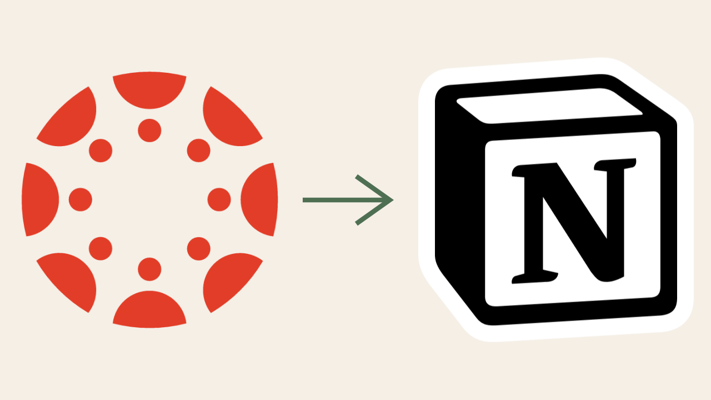

# Canvas to Notion Integration

Synchronize active Canvas assignments, quizzes, and discussions into a personal Notion database. The CLI runs on your own computer and uses credentials that remain in your local `.env` file.



## Requirements

- Node.js 22 or newer
- A Canvas access token
- A Notion internal integration
- A Notion page shared with that integration

## Local setup

Clone the repository and install the locked dependencies:

```bash
git clone https://github.com/marigarey/canvas-notion-integration.git
cd canvas-notion-integration
npm ci
cp .env.example .env
```

Edit `.env` and provide your own values:

```dotenv
CANVAS_API_URL=https://school.instructure.com
CANVAS_API=your_canvas_access_token
NOTION_API=your_notion_integration_secret
NOTION_PAGE=your_notion_parent_page_id
NOTION_DATABASE=
NOTION_DATA_SOURCE=
```

Leave `NOTION_DATABASE` and `NOTION_DATA_SOURCE` empty on the first run. The CLI creates a database and saves only its non-secret IDs in `.canvas-notion-state.json` with owner-only file permissions.

If you are upgrading from version 2.1, move `src/.env` to the repository root before running the new CLI. Existing `NOTION_DATABASE` values remain supported; the first run resolves and stores the corresponding Notion data-source ID.

### Canvas token

In Canvas, open **Account → Settings → Approved Integrations → New Access Token**. Use the origin of your school Canvas site for `CANVAS_API_URL`; HTTPS is required.

### Notion integration

Create an internal integration at [Notion integrations](https://www.notion.so/my-integrations), copy its secret into `NOTION_API`, and add the integration as a connection to the parent page. Copy the parent page ID into `NOTION_PAGE`.

## Run

Preview changes without writing to Notion:

```bash
npm run dry-run
```

Run the synchronization:

```bash
npm start
```

The command exits with a nonzero status when configuration, Canvas, Notion, or any item synchronization fails. Repeated successful runs update existing items using a stable Canvas key instead of creating duplicates.

## Docker

Build locally:

```bash
docker build -t canvas-notion-integration .
```

Run with credentials supplied at runtime and a persistent state volume:

```bash
docker run --rm \
  --env-file .env \
  --mount type=volume,src=canvas-notion-data,dst=/app/data \
  canvas-notion-integration
```

After a release is published, replace the local image name with `ghcr.io/marigarey/canvas-notion-integration:main`.

## Security

- `.env` and local state are excluded from Git and Docker build contexts.
- Canvas tokens are sent in the `Authorization` header, never in request URLs.
- Canvas pagination links cannot send credentials to another origin or API path.
- Notion credentials are never written to the state file.
- An inaccessible configured database causes a failure rather than silently creating a duplicate.

Never paste access tokens into an issue, pull request, screenshot, or support message. If a token is exposed, revoke or rotate it with the provider immediately.

## Development

Run syntax checks and the test suite:

```bash
npm run check
```

The CI workflow runs the same checks, audits production dependencies, and builds the Docker image for every pull request. Images are published only after a successful push to `main`.

## Current behavior

- All active courses are retrieved using Canvas pagination.
- Assignments, quizzes, and discussions are synchronized sequentially to respect API limits.
- Existing databases created by older CLI versions are upgraded with stable `Canvas Key` and `Type` properties.
- The CLI does not delete Notion pages when an item disappears from Canvas.

See [SECURITY.md](./SECURITY.md) for vulnerability reporting guidance.
